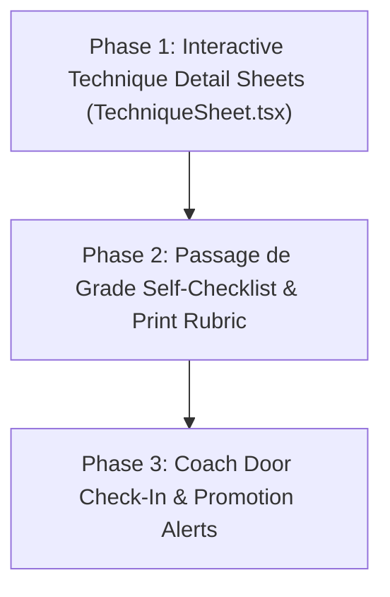

# UBa Judo Club — Execution Plan for Remaining Roadmap Items

This plan outlines the architecture, data sourcing strategy, and step-by-step implementation for the remaining features on the UBa Judo Club platform roadmap.

---

## Overview of Remaining Tasks

| Priority | Feature Item | Primary Target | User Persona |
| :---: | :--- | :--- | :--- |
| **01** | **Interactive Technique Detail Sheets** | `TechniqueSheet.tsx` & `/techniques` | Students & Athletes |
| **02** | **Passage de Grade Checklist & Printable Rubric** | `PassageDeGradeSection.tsx` & `/belts/:color` | Candidates & Senseis |
| **03** | **Coach Mat Check-In & Promotion Automation** | `/dashboard/*` & `CheckInPanel.tsx` | Head Coach & Club Staff |

---

## 1. Interactive Gokyo & Technique Detail Sheets (`TechniqueSheet.tsx`)

### Objective
Provide judoka with an elite, interactive visual study sheet whenever they tap or search for any of the 76 Kodokan Gokyo throws, groundwork pins, turnovers, strangles, or armbars.

### Key Capabilities
1. **Three-Phase Throw Biomechanics (*Kuzushi* → *Tsukuri* → *Kake*)**:
   - Visual breakdown of off-balancing direction (*Happō-no-kuzushi*), body positioning, and final execution.
2. **Video / Animated Looping Mat Demonstration**:
   - High-performance, lightweight video demonstration loop with play/pause, slow-motion (0.5x), and scrub controls.
3. **Coaching Cues & Common Errors to Avoid**:
   - 2 key tactical cues + collapsible checklist of common pitfalls (e.g., pulling downwards instead of driving upward).
4. **Interactive Counters & Combination Links**:
   - Clickable linked pills to related techniques (e.g., from *Ouchi Gari* directly jump to *Uchi Mata* or *Kouchi Gari*).

### Best Method to Source & Integrate
- **Data Source**:
  - Registry: [app/lib/data/syllabus/techniques.ts](file:///c:/Users/Dev%20Lee/Documents/@DevLee/apps/ubajudo/app/lib/data/syllabus/techniques.ts) already contains `details.kuzushi`, `details.tsukuri`, `details.kake`, `cues`, `safety`, and `group`.
  - Enrich with `videoUrl` (Cloudinary streaming or local webm loops) and `kuzushiAngle` (0° to 360° direction indicator).
- **Video Sourcing Strategy**:
  - Use Cloudinary auto-format video transforms (`f_auto,q_auto,vc_h264,w_800`) stored in the club's Cloudinary account (`dgcp1zazk`).
  - Fallback to Kodokan public domain vector diagrams and instructional GIFs when video is unavailable.
- **Component Architecture**:
  - Enhance [app/components/belts/TechniqueSheet.tsx](file:///c:/Users/Dev%20Lee/Documents/@DevLee/apps/ubajudo/app/components/belts/TechniqueSheet.tsx).
  - Use URL search param sync (`?tech=<id>`) so techniques are directly shareable via link and accessible via the Spotlight Search.

---

## 2. Passage de Grade Assessment Checklist & Printable Grading Rubric

### Objective
Equip judoka to track their personal exam readiness and provide coaches with an official, print-ready grading examination sheet for end-of-term Dan and Kyu promotion boards.

### Key Capabilities
1. **Interactive Self-Assessment Readiness Tracker**:
   - Candidate checks off throws, groundwork holds, escape sequences, and Japanese terminology they have mastered.
   - Dynamic radial progress ring: displays `% Ready for Exam` and highlights remaining gaps.
   - Saved locally in browser storage (`localStorage`) so athletes never lose their progress.
2. **Official One-Click Print Exam Rubric**:
   - Senseis can click "Print Official Grading Sheet".
   - Formatted using standard CSS print rules (`@media print`, `@page { size: A4 portrait; margin: 12mm; }`) for a crisp, high-density, ink-efficient examination scorecard featuring candidate name, attendance verification, score blocks (0–10), and Sensei signature fields.

### Best Method to Source & Integrate
- **Data Source**:
  - [app/lib/data/syllabus/programs/*.ts](file:///c:/Users/Dev%20Lee/Documents/@DevLee/apps/ubajudo/app/lib/data/syllabus/) contains the formal exam specifications: `exam.technical`, `exam.kata`, `exam.randori`, and minimum session threshold.
- **State Management**:
  - Lightweight Zustand store with `persist` middleware (`app/lib/stores/readiness.store.ts` using `uba-grade-readiness-<color>`).
- **Component Architecture**:
  - Embed the candidate checklist directly into [app/components/belts/PassageDeGradeSection.tsx](file:///c:/Users/Dev%20Lee/Documents/@DevLee/apps/ubajudo/app/components/belts/PassageDeGradeSection.tsx).
  - Add a dedicated print modal/sheet [app/components/belts/GradingPrintSheet.tsx](file:///c:/Users/Dev%20Lee/Documents/@DevLee/apps/ubajudo/app/components/belts/GradingPrintSheet.tsx) with a clean button: `window.print()`.

---

## 3. Coach Dashboard & Mat Check-In Flow

### Objective
Streamline session attendance logging at the Amphi 100 door and provide coaches with automatic student promotion alerts when session attendance thresholds are met.

### Key Capabilities
1. **Rapid 1-Tap Mat Check-In**:
   - Fast athlete search with fuzzy autocomplete by student name, matricule, or belt rank.
   - 1-tap check-in with instant auditory/visual confirmation and attendance counter increment.
2. **Automatic Promotion Eligibility Tracker**:
   - Dashboard widget flagging athletes who have crossed their required session milestone (e.g., White Belt with 24+ sessions, Yellow with 32+ sessions).
   - "Eligible for Next Grading" banner with direct link to view their upcoming belt curriculum.
3. **Session Wrap-Up & Photo Publishing**:
   - Session focus tagging (e.g., *Ouchi Gari Counters & Randori*).
   - One-click photo upload directly to Cloudinary and instant publication to the public `/sessions` feed.

### Best Method to Source & Integrate
- **Data Source & Persistence**:
  - Supabase backend:
    - `public.profiles`: athlete records, current belt, total sessions.
    - `public.sessions`: mat training sessions with dates, focus, and coach notes.
    - `public.session_attendance`: pivot records linking judoka to sessions.
- **Client Queries & Mutations**:
  - Utilize TanStack Query hooks in [app/lib/api/session.queries.ts](file:///c:/Users/Dev%20Lee/Documents/@DevLee/apps/ubajudo/app/lib/api/session.queries.ts) and [app/lib/api/member.queries.ts](file:///c:/Users/Dev%20Lee/Documents/@DevLee/apps/ubajudo/app/lib/api/member.queries.ts).
- **Component Architecture**:
  - Modernize [app/components/coach/CheckInPanel.tsx](file:///c:/Users/Dev%20Lee/Documents/@DevLee/apps/ubajudo/app/components/coach/CheckInPanel.tsx) with an auto-focus search bar and live attendance counter.
  - Upgrade [app/components/coach/AthletesPanel.tsx](file:///c:/Users/Dev%20Lee/Documents/@DevLee/apps/ubajudo/app/components/coach/AthletesPanel.tsx) with a filter tab: `Eligible for Grading (N)`.

---

## Suggested Implementation Sequence

1. **Step 1**: Implement Phase 1 (`TechniqueSheet.tsx`) — immediately enriches the student learning experience and integrates with the Spotlight Search.
2. **Step 2**: Implement Phase 2 (`PassageDeGradeSection.tsx` & print scorecard) — delivers value for both grading candidates and club Senseis.
3. **Step 3**: Implement Phase 3 (`CheckInPanel.tsx` & promotion alerts) — finalizes the coach operational workflows.
